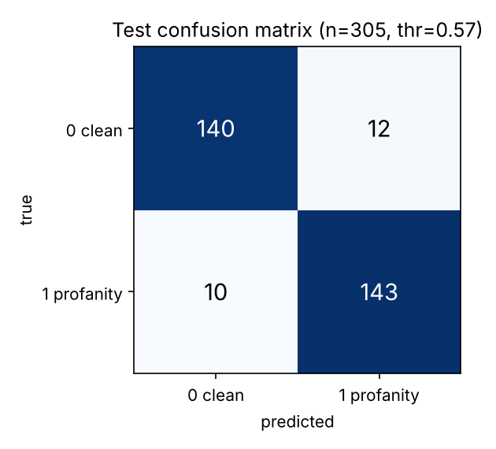

# Kazakh Profanity Detection

DSSC5113 Algorithms of Computer Vision · Bonus project · Fall 2026
**Author:**Kalashnikova Viktoriya · **Student ID:** 25MD0173

A character-level CNN, trained from scratch, that reads one Kazakh review or comment and predicts whether it contains profanity.

- **Input:** one comment (any length, Cyrillic or Latin script, possibly mixed with Russian).
- **Output:** `0` = no profanity, `1` = profanity present, plus the model's probability `p(profanity)`.

| Test set (n = 305) | Precision | Recall | F1 |
|---|---:|---:|---:|
| Profanity class (1) | 0.923 | 0.935 | 0.929 |

---

## 1. Quick start

```bash
git clone <this repository>
cd kazakh-profanity-detection
python -m venv .venv && source .venv/bin/activate     # optional
pip install -r requirements.txt
```

**Predict with the saved model (no retraining needed):**

```bash
python scripts/predict.py "Тауар жақсы, маған ұнады"
# 0 (clean)  p(profanity)=0.000  threshold=0.57  | Тауар жақсы, маған ұнады

python scripts/predict.py            # interactive: type comments, empty line to quit
```

From Python:

```python
import sys; sys.path.insert(0, "src")
from inference import ProfanityClassifier
clf = ProfanityClassifier("artifacts")
clf.predict(["Тауар жақсы, маған ұнады", "к*т приложения екен"])   # -> [(label, probability), ...]
```

**Run everything in one notebook:** `kazakh_profanity_detection.ipynb` contains the whole pipeline with explanations (data → splits → preprocessing → model → training → one test evaluation → predictions on your own text). Locally: open it in the repository root and run all cells. In Google Colab: put the repository URL into `REPO_URL` in the first code cell and choose *Runtime → Run all*; the cell clones the repository and installs `requirements.txt`. The notebook reproduces the saved model in `artifacts/` byte for byte with the pinned versions. On other package versions (for example Colab's own PyTorch) the numbers can differ slightly.

**Or reproduce with the scripts:**

```bash
python scripts/prepare_data.py --input data/labeled.csv --out data/processed   # dedup + split (seed 42) + label fixes
python scripts/train.py --config configs/train.json --data data/processed --out artifacts
python scripts/evaluate.py --data data/processed --artifacts artifacts --out results
```

Training takes about one minute on a laptop CPU. With the pinned versions it is deterministic: two runs produced byte-identical `model.pt`.

## 2. Repository layout

```
kazakh_profanity_detection.ipynb   the whole pipeline in one notebook (same code as scripts/ + src/)
configs/train.json        all training settings and the random seed
data/labeled.csv          labeled dataset (public, privacy-cleaned), 3,058 comments
data/label_corrections.csv  label fixes found during review (applied by prepare_data.py)
data/processed/           train / val / test splits + split_stats.json
scripts/privacy_review.py step 0, run once by the author on the private file (see 3.4)
scripts/prepare_data.py   step 1: deduplicate, group near-duplicates, split
scripts/train.py          step 2: train, early stopping and threshold on validation
scripts/evaluate.py       step 3: one evaluation on the test set
scripts/predict.py        predict on new comments
src/textproc.py           normalization, character vocabulary, encoding
src/model.py              CharCNN
src/inference.py          ProfanityClassifier: loads artifacts and predicts
artifacts/                model.pt, vocab.json, config.json (incl. threshold), training_log.csv
results/                  test_metrics.json, confusion_matrix.png, test_predictions.csv
```

All model files are small (the weights are 272 KB) and are stored in this repository.

## 3. Dataset

### 3.1 Source

All texts come from **KazSAnDRA** (Kazakh Sentiment Analysis Dataset of Reviews and Attitudes, ISSAI, Nazarbayev University; [GitHub](https://github.com/IS2AI/KazSAnDRA), [paper](https://arxiv.org/abs/2403.19335), license CC BY 4.0). KazSAnDRA has 180k Kazakh reviews with 1–5 star ratings but **no profanity labels**. The profanity labels in this project are my own.

The column `kazsandra_id` keeps the original KazSAnDRA id of every comment, so each text can be traced back to the source. No synthetic examples are used: every text is a real KazSAnDRA review. The only edits are the privacy edits described in 3.4.

To get the source data: `git clone https://github.com/IS2AI/KazSAnDRA.git`; the CSV files are zipped in `dataset/` (the score-classification files `06`, `09`, `10` cover all 1–5 star reviews).

### 3.2 How the data relates to product reviews

| KazSAnDRA domain | Reviews of | Clean (0) | Profanity (1) | Total |
|---|---|---:|---:|---:|
| appstore | mobile apps and games (digital products) | 1,202 | 1,519 | 2,721 |
| market | goods on online marketplaces | 189 | 2 | 191 |
| mapping | shops, clinics, places | 85 | 10 | 95 |
| bookstore | books | 45 | 6 | 51 |
| **total** | | **1,521** | **1,537** | **3,058** |

Marketplace reviews of physical goods are moderated by the platforms and contain very little profanity (2 of the 191 marketplace reviews here). Profane comments therefore come almost entirely from app-store reviews. App and game reviews are reviews of digital products, written by the same users in the same informal style. Marketplace, mapping and bookstore reviews were added to the clean class so that the model also sees ordinary product-review language.

### 3.3 Labeling rules

Label **1** if the comment contains at least one of:

- **Kazakh obscene words** and their derived forms, e.g. `қотақ`, `котакбас`, `ам`, `шешеңнің …`, `көт`;
- **Kazakh insulting words used as insults**, e.g. `мал`, `есек`, `ит`, `далбаса` when they are aimed at a person or at the product;
- **Russian obscene words (мат) inside a Kazakh comment**, e.g. `бля`, `заебал`, `говно`. Kazakh users mix Kazakh and Russian freely, and a moderator would remove these comments, so they count as profanity no matter which language the swear word comes from;
- **masked or distorted forms**: asterisks or symbols (`к*т`, `бл*ть`, `з@еб@**л`), stretched letters (`бляяяя`), phonetic spellings (`зайбал`, `пиздес`), Latin transliteration (`Boq ekengoy`, `zaebal`), and abbreviations (`шшс`).

Label **0** for everything else, including:

- **negative reviews without profanity.** A negative review is not automatically profane: 538 one-star reviews are labeled 0, and 587 five-star reviews are labeled 1;
- **talking about swearing** without swearing, e.g. `Боқтама` ("don't swear");
- **look-alike strings**: `мал` meaning livestock or inside other words (`малодец`, `Ассалаумалейкум`), masked non-profane words (`х@кер` = hacker).

**Ambiguous cases** were labeled by intent: is the word used to insult or to swear? `мал` is the hardest case. In `Мал ойын тартпаңдар` ("trash game, don't download") it is an insult (1). In `мал шаруашылығы` ("livestock farming") it is a neutral word (0).

**Examples:**

| Label | Comment | Why |
|---:|---|---|
| 0 | Тауар жақсы, маған ұнады. Уақытынан бұрын тез келді, рахмет. | ordinary product review |
| 0 | Қызмет көрсету өте нашар. … | negative, no profanity |
| 0 | Боқтама | talks about swearing |
| 0 | … ойында какойто х@кер кіреді … | masked "hacker", not profanity |
| 1 | Котакбас ойын | Kazakh obscene insult |
| 1 | Қысқасаын айтқанда к*т приложения екен дұрыс істемейді | masked Kazakh word |
| 1 | жарнама заебал болды | Russian мат in a Kazakh comment |
| 1 | Boq ekengoy | Latin transliteration |
| 1 | Мал ойын тартпаңдар. Кірмейді. … | `мал` as an insult |

### 3.4 Privacy

The comments were written by members of the public. Some contain names, ages or schools of private people. Before publishing:

- Latin `@handles` were replaced by `@user`;
- **3 comments were removed**: they identify or sexualize private people, some of them children;
- in **26 comments**, names of private people (reviewers, staff, doctors, friends) and one home address were replaced by `[NAME]`. Public figures were kept.

I found these by a keyword search (names, ages, schools, phone numbers, surname endings) and read every hit. `scripts/privacy_review.py` applies the edits. Its input file and the list of edits contain the original names, so they are **not** in this repository. `data/labeled.csv` is its output and is the starting point for all other steps.

### 3.5 Splits

`scripts/prepare_data.py`:

1. Removes **exact duplicates** after normalization (lowercase, no punctuation, emoji or digits, letter runs shortened): 6 rows.
2. Finds **near-duplicates**: character 3–5-gram TF-IDF cosine similarity ≥ 0.9, e.g. `пиздец ойын` / `Пиздец ойын ғо`. It groups them (16 groups) so that each group goes to **one** split. In the original split, about 10 near-duplicate pairs crossed splits.
3. Splits 80 / 10 / 10 with `StratifiedGroupKFold` (stratified by label, grouped by near-duplicate group), **random seed 42**.
4. Applies **label fixes** from `data/label_corrections.csv`: two comments with Kazakh obscene words (`Қотақ амсын была`, `Қотақбас екен`) were labeled 0 by mistake and are corrected to 1. Both are in the training split. The fixes are applied *after* the split, so the split and the test set are exactly the same as with the original labels.

| Split | Rows | Clean (0) | Profanity (1) |
|---|---:|---:|---:|
| train | 2,442 | 1,214 | 1,228 |
| val | 305 | 152 | 153 |
| test | 305 | 152 | 153 |

The character vocabulary is built from the **training split only**.

## 4. Model

### 4.1 Why a character-level CNN

Profanity in these comments is written in many surface forms: masked (`к*т`), stretched (`бляяя`), misspelled (`зайбал`), transliterated (`Boq`), glued to other words (`котакбас`, `Шешенсыгин`), and in two languages. A word-level model would see most of these forms as unknown words. A **character-level** model reads the letters themselves, so all these variants share character n-grams such as `кот`, `бля`, `аеб`.

A small CNN fits the task. Each convolution filter learns to detect a short character pattern, and **max-pooling over positions** keeps the strongest match anywhere in the comment. That matches the label definition: a comment is profane if a profane fragment appears *anywhere*. The model has 68k parameters, trains from scratch in about a minute on a CPU, and needs no external pretrained weights.

### 4.2 From raw text to prediction

```
"Котакбас ОЙЫН!!!"
 → normalize: NFKC, lowercase, letter runs > 2 cut to 2, digits → 0, spaces collapsed
   "котакбас ойын!!"
 → characters → ids from the training vocabulary (249 symbols: <pad>=0, <unk>=1, …)
 → pad to 300 characters                                   (1, 300)
 → Embedding(249, 48)                                       (1, 300, 48)
 → Conv1d kernel 3, 4, 5 × 96 filters each + ReLU           3 × (1, 96, 300)
 → max over positions (padding masked out)                  3 × (1, 96)
 → concatenate → dropout 0.3                                (1, 288)
 → Linear(288, 2) → softmax → p(profanity)
 → label = 1 if p(profanity) ≥ 0.57
```

- **Punctuation** is kept: `*` and `@` are often the mask in `с*ка`, `қот@қ`.
- **Unknown characters** (seen fewer than 2 times in training) map to `<unk>`. Unknown *words* are not a problem, because the model never works with words.
- **Long comments:** 3.6% of training comments are longer than 300 characters. For those, the first 150 and the last 150 characters are kept, because profanity can be at either end.

### 4.3 Training

| Setting | Value |
|---|---|
| Loss | cross-entropy (2 logits) |
| Optimizer | AdamW, lr 0.002, weight decay 1e-4 |
| Batch size | 64 |
| Epochs | up to 30; early stopping, patience 5 on validation F1 of class 1 |
| Selected epoch | 8 (validation F1 0.933 at threshold 0.5) |
| Decision threshold | 0.57, chosen on validation to maximize F1 (grid 0.05–0.95) |
| Seed | 42 (Python, NumPy, PyTorch, shuffling; deterministic algorithms on) |

All settings are in `configs/train.json`. The validation set chose the epoch and the threshold. The test set was not used for any decision. The per-epoch log is in `artifacts/training_log.csv`.

## 5. Results (test set, evaluated once)

n = 305 (152 clean, 153 profanity), threshold 0.57. Source: `results/test_metrics.json`.

| | Precision | Recall | F1 |
|---|---:|---:|---:|
| Profanity class (1) | 0.923 | 0.935 | 0.929 |

Accuracy 0.928.

|  | predicted 0 | predicted 1 |
|---|---:|---:|
| **true 0** | 140 (TN) | 12 (FP) |
| **true 1** | 10 (FN) | 143 (TP) |



**Domain check.** Almost all profane comments are app reviews, so the model could in principle learn "app review → profane" instead of profanity itself. On the app-review subset alone (n = 276), F1 is 0.934, about the same as on the full test set. So the model is not relying on the domain.

### 5.1 What the errors mean for moderation

- **False positive** (12): a clean review is flagged as profane. If moderation is automatic, a legitimate review, perhaps an honest negative one, is hidden. This hurts the reviewer and makes the platform look like it censors criticism.
- **False negative** (10): a profane review is missed and stays visible to all users, including children.

For a marketplace, a sensible setup is to **send flagged comments to a human moderator instead of deleting them automatically**. Then false positives cost a moderator a few seconds, and the threshold can be lowered to catch more profanity (higher recall). If comments were deleted automatically, false positives would matter more and a higher threshold would be safer. The threshold is a single number in `artifacts/config.json`, so it can be changed without retraining.

### 5.2 Error analysis

All test predictions with probabilities are in `results/test_predictions.csv`.

| Comment (test set) | True | p(profanity) | Likely reason |
|---|---:|---:|---|
| `akbo*** екі шетінде галочка бар …` | 0 | 0.996 | The asterisks hide part of a name or login, not a swear word. The model learned that `***` usually means masked profanity. |
| `💩💩💩💩💩👎👎👎👎👎 басында оинағанда …` | 0 | 0.867 | The only rude element is emoji, and this comment is labeled 0. Emoji like 💩 often appear next to profanity in training. |
| `10.0 10.0 10.0` | 0 | 0.876 | Very short comments are often flagged (also `2 бала`, `ал кеттик`). Many profane training comments are short, so the model partly links "short" with "profane". |
| `Зоре шшс` | 1 | 0.480 | `шшс` is an abbreviation of an obscene phrase. It is rare in training, and three letters give the CNN little signal: a similar comment `зор шшс нагыз …` is caught (0.735), this one falls just below the threshold. |
| `Менің өмірімде көрген ең мал ойын 👎` | 1 | 0.382 | `мал` is an insult here, but the same letters are clean in many training comments (`малодец`, livestock). The model must use context, and with this little data it is unsure. |
| `Дәрігер [NAME] шынымен есек екен …` | 1 | 0.012 | The insult `есек` sits inside a long, polite, formal review of a clinic. Most profane training comments are short app reviews. |
| `өте күшті емес сука` | 1 | 0.080 | A Russian swear word after Kazakh words that usually start positive reviews (`өте күшті` = "very cool"). A likely reason: the model weighs the strong "positive review" pattern more than one short swear word at the end. |

**Practical improvements:**

1. **More data for rare forms.** Label more comments with abbreviations (`шшс`), `есек`/`мал` used as insults, and long formal complaints. These are the main sources of false negatives.
2. **Normalize masks and emoji.** Treat masked names (`akbo***`) and profanity masks differently. For example, keep a mask only when it sits inside a word that also matches a known swear stem, and map emoji to one token.
3. **Context.** A small word-level or pretrained multilingual model (e.g. XLM-R) on top of, or instead of, the character CNN could tell insulting `мал` from neutral `мал` by context.

## 6. Limitations

- **One annotator.** All labels are mine, without a second annotator or agreement measure. The boundary of "insult" (`мал`, `есек`) is subjective. During review I found and fixed two clear labeling errors (`data/label_corrections.csv`), and there are probably more: e.g. comments with `көт`/`есек` are labeled 0 in one place and 1 in another.
- **Domain.** 99% of profane comments are app reviews. Performance on profane marketplace reviews is untested, because there are almost none.
- **Small test set.** With 305 test comments, F1 has an uncertainty of a few percentage points. Differences of 1–2 points mean little.
- **One model, one seed.** No repeated-seed study was run (the project allows this). Results are sensitive to small changes: fixing the labels of 2 of the 2,442 training comments moved test F1 from 0.893 to 0.929, mostly because training stopped at a different epoch (10 → 8), not because of those two comments. Differences of a few points between runs should not be over-interpreted.
- **Privacy review is manual.** It can miss names it did not search for.

## 7. Acknowledgements and AI assistance

The dataset for the task was altogether gathered by master degree students of Deep learning class. Claude was used for code writing and debugging, all cells were manually checked and launched from scratch.
